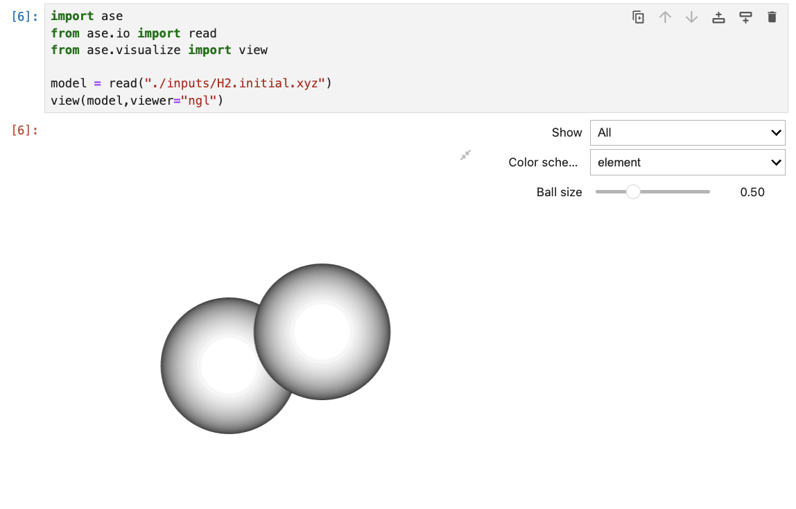

[🏠 Home](../../../../README.md) › [💡 計算技術](../../README.md) › [ASE](../ase.md)

# ASE を利用したモデル構造の可視化

## 1. 画面上で構造を確認する（`ase.visualize`）

手順は2段階だけ．`ase.io.read` で構造ファイルを読み込み，`ase.visualize.view` に渡す．

```python
from ase.io import read
from ase.visualize import view

model = read("./inputs/H2.initial.xyz")
view(model, viewer="ngl")   # Jupyter 上でインタラクティブに回せる
```

<figure style="text-align:center;">
  
  <figcaption style="font-size:20px; margin-top:5px;">Fig: Jupyter Notebook 上での表示例</figcaption>
</figure>

> 💬 `viewer="ngl"` には `nglview` パッケージが必要（`pip install nglview`）．
> 指定しない場合は ASE 標準の GUI ビューアが別ウィンドウで開く．

## 2. 画像ファイルとして保存する（`ase.io.write`）

論文・スライド用に静止画が欲しい場合は `write` に画像の拡張子を渡す．
`rotation` で視点を指定できる．

```python
from ase.io import write
from IPython.display import Image

write("output/si.png", atoms, rotation="0x,0y,0z")
Image(url="output/si.png", width=200)
```

## 3. 参考

Matlantis のマニュアルに [ASE の可視化](https://docs.matlantis.com/atomistic-simulation-tutorial/ja/Appendix_1_visualization.html)
の詳しい解説がある．視点の指定や複数構造の並べ方まで載っており，非常に参考になる．

> 💬 結晶構造を論文品質で描きたい場合は，[VESTA](../../vesta/vesta.md) のほうが向いている．
> ASE での可視化は「スクリプトの途中で構造が壊れていないか確認する」用途に使うとよい．

---

[⬅️ ASE](../ase.md) ｜ [🏠 Home](../../../../README.md)
