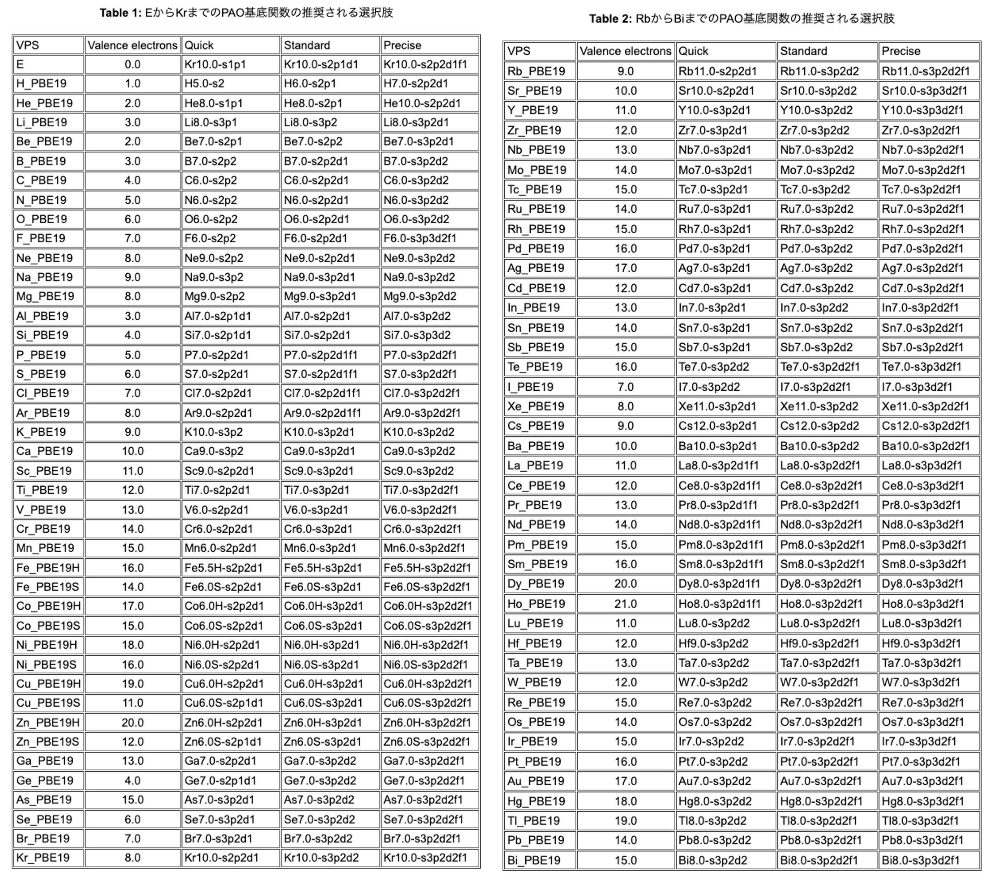

[🏠 Home](../../../../README.md) › [💡 計算技術](../../README.md) › [OpenMX](../openmx.md)

# 基本的なパラメタ設定の勘所・収束のスキル

## 【結論】接頭辞を見れば，どのパラメタを疑うべきかが分かる

OpenMX の入力パラメタには命名規則があり，**どの計算段階に属するかが接頭辞で分かる**．

| 接頭辞 | 対象 | 疑うべき場面 |
|---|---|---|
| `scf.###` | Kohn-Sham 方程式の自己無撞着計算（SCF: self-consistent field） | SCF が収束しない |
| `MD.###` | 原子座標を動かす計算（構造最適化・NEB・分子動力学） | 構造最適化が収束しない／振動する |

> 💡 **SCF 計算で問題が生じた場合は `scf.###` を，MD 計算で問題が生じた場合は `MD.###` を精査する．**
> これが計算エラー解決のための最も単純で有効な指針になる．

---

## 1. ✅ 重要なパラメタの一覧

太字が「まず選ぶべき値」である．

| パラメタ | 制御するもの | 選択肢（太字＝推奨） |
|---|---|---|
| `Definition.of.Atomic.Species`（1列目） | 擬ポテンシャル | **従来型** / オープンコア型 / 内殻準位励起用 |
| `Definition.of.Atomic.Species`（2列目） | 有効擬原子軌道（基底） | Quick / **Standard** / Precise |
| `scf.XcType` | 交換相関エネルギー | LDA / LSDA-CA / LSDA-PW / **GGA-PBE** |
| `scf.energycutoff` | カットオフエネルギー | **200〜250 Ry** |
| `scf.ElectronicTemperature` | 電子温度 | **300 K** |
| `scf.Kgrid` | k 空間メッシュ | 系に依存 |
| `scf.criterion` | SCF の収束条件 | 系に依存（後述の概算式） |
| `scf.Mixing.Type` ほか | 電子密度の更新方法 | **rmm-diisk** |

---

## 2. 📄 パラメタの詳細

### 2.1 擬ポテンシャル（`Definition.of.Atomic.Species` 1列目）

選択肢は従来型・オープンコア型・内殻準位励起用の3種類．
**基底状態の計算では従来型を用いればよい．**
具体的な名前は図1（OpenMX [公式ページ](https://www.openmx-square.org/openmx_man3.9jp/node27.html)より）の
Table 1, 2 の VPS 欄を参照して選ぶ．

### 2.2 有効擬原子軌道（`Definition.of.Atomic.Species` 2列目）

ベンチマーク計算により最適化された[データベース](https://www.openmx-square.org/openmx_man3.9jp/node27.html)が
提供されているため（図1），そこから選べばよい．**基本は Standard で十分．**

### 2.3 交換相関エネルギー（`scf.XcType`）

初めての計算では **GGA-PBE** か **LDA** を選べばよい．
なお，計算精度がここの選択に依存するのが DFT の原理的な制約である．

### 2.4 カットオフエネルギー（[`scf.energycutoff`](https://www.openmx-square.org/openmx_man3.8jp/node37.html)）

経験的には **200〜250 Ry** 程度で多くの系は十分に収束する．

> 💡 **特に構造最適化計算では重要なパラメタであり，値を大きくすると収束性が改善することがある．**
> これは，カットオフエネルギーが小さいと実空間メッシュが粗くなり，
> その結果として原子位置が最適化の過程で振動しやすくなるためである．

### 2.5 電子温度（`scf.ElectronicTemperature`）

Fermi エネルギー近傍のバンドの占有数の扱いには工夫（スメアリング）が必要で，その幅を与えるのがこのパラメタ．
初めての計算では **300 K 程度**を推奨する．

### 2.6 k 空間メッシュ（`scf.Kgrid`）

逆格子空間でのサンプリング点の刻みを定義する．
セルが大きい系では少ない点数で足り，構造最適化の収束性には直接は関与しない．

> 📝 詳細は加筆予定．

### 2.7 SCF の収束条件（`scf.criterion`）

Kohn-Sham 方程式の SCF 計算を打ち切る，バンドエネルギーの総和の差分のしきい値．
デフォルトは `1.0E-6 [Hartree]` だが，**基本的にはデフォルトより深い値を設定したほうがよい．**

必要な値は系のサイズに依存する．`1.0 [Hartree] = 27.21 [eV]` であることから，
原子1個あたりおよそ 30 倍のオーダー差を見込んで概算する：

$$
{\rm scf.criterion} \simeq \frac{\text{欲しい精度}\ [{\rm eV}]}{\text{原子数} \times 30}\ [{\rm Hartree}]
$$

たとえば 100 原子のモデルで全エネルギーを `1.0E-3 [eV]` のオーダーまで収束させたい場合：

$$
\frac{1.0\times 10^{-3}}{100 \times 30} \simeq 1.0\times 10^{-7}\ [{\rm Hartree}]
$$

### 2.8 電子密度の混合（`scf.Mixing.###`）

SCF 計算では，電子密度 → 有効ポテンシャル → Kohn-Sham 方程式 → 新しい電子密度，というループを回す．
このとき新旧の電子密度をそのまま入れ替えると振動して収束しないため，
**過去の電子密度と混ぜて次のステップの入力を作る**．この混ぜ方を制御するのが一連の `scf.Mixing.###` である．

| パラメタ | 意味 |
|---|---|
| `scf.Mixing.Type` | 混合アルゴリズム |
| `scf.Init.Mixing.Weight` | 初期の混合比 |
| `scf.Min/Max.Mixing.Weight` | 混合比の下限・上限 |
| `scf.Mixing.History` | 混合時に参照する過去ステップ数 |
| `scf.Mixing.StartPulay` | Pulay 混合を開始するステップ |

混合の設定は SCF の収束性に大きく影響する．`scf.Mixing.StartPulay` は
[比較的大きめに設定することが推奨されている](https://www.openmx-square.org/openmx_man3.8jp/node42.html)．

```
# -----------------------------------------------------------
# Example of mixing parameters for update of electron density
# -----------------------------------------------------------

scf.Mixing.Type               rmm-diisk # 基本) rmm-diisk を使用
scf.Init.Mixing.Weight        0.05      # 初期の電子密度の混合比
scf.Min.Mixing.Weight         0.01      # 混合比の最小値
scf.Max.Mixing.Weight         0.30      # 混合比の最大値
scf.Mixing.History            25        # 混合時に参照する履歴数
scf.Mixing.StartPulay         15        # 気にしない（他パラメタの調整でうまくいく）
```

---

## 3. 📊 参考：VPS & PAO テーブル

<figure style="text-align:center;">
  
  <figcaption style="font-size:20px; margin-top:5px;">図1: OpenMX VPS &amp; PAO Tables</figcaption>
</figure>

---

[⬅️ OpenMX](../openmx.md) ｜ [🏠 Home](../../../../README.md)
