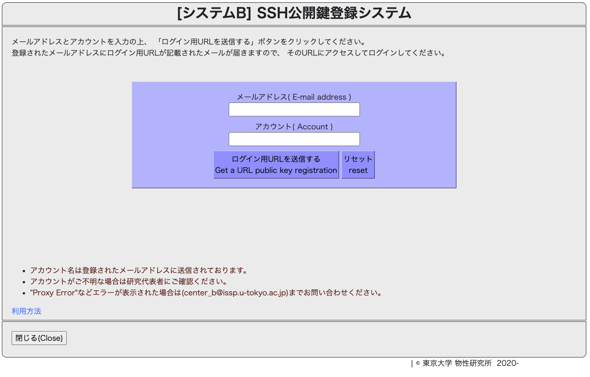
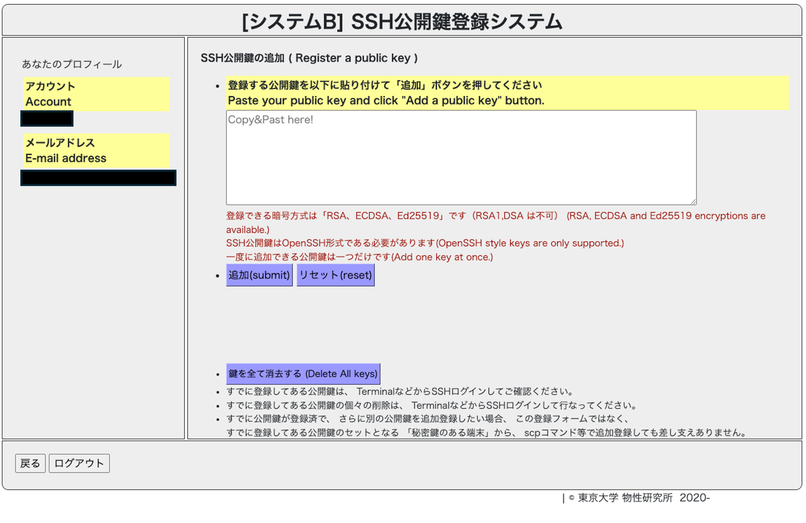

[🏠 Home](../../../../README.md) › [🖧 外部計算機](../../README.md) › [SystemB](../systemb.md)

# 物性研 SystemB へのログイン方法

[SystemB (ohtaka)](https://mdcl.issp.u-tokyo.ac.jp/scc/system/systembinfo) でアカウントを取得した前提で，
ログインできるようになるまでの手順をまとめる．

```
① 利用者登録（完了済みとする） ──> ② SSH 鍵ペアの作成 ──> ③ 公開鍵の登録 ──> ④ ssh でログイン
```

---

## 1. SSH 鍵ペアを作成する

手元のマシンで鍵ペア（秘密鍵と公開鍵）を作る．作成手順は以下の記事が分かりやすい．

* [Mac 用](https://qiita.com/soma_sekimoto/items/35845495bc565c38ae9d)
* [Windows 用](https://qiita.com/digdagdag/items/9e5c061e7d86e0af9a57)

> ⚠️ **登録するのは公開鍵（`*.pub`）のみ．秘密鍵は絶対に登録・送信しないこと．**
> 秘密鍵が漏れると，第三者があなたのアカウントでログインできてしまう．

## 2. 公開鍵を登録する

利用者登録が完了すると，登録メールアドレス宛に **SSH 公開鍵登録システム**の URL が送られてくる（図1）．
サイトの指示に従って公開鍵を登録する（図2）．

<figure style="text-align:center;">
  
  <figcaption style="font-size:20px; margin-top:5px;">図1: 公開鍵登録システム ログイン画面</figcaption>
</figure>

<figure style="text-align:center;">
  
  <figcaption style="font-size:20px; margin-top:5px;">図2: 公開鍵登録画面</figcaption>
</figure>

## 3. ssh でログインする

鍵の登録が反映されると，ssh での接続が可能になる．以下のいずれかの形式でログインする．

```bash
# 既定の鍵（~/.ssh/id_rsa など）を使う場合
ssh {username}@ohtaka.issp.u-tokyo.ac.jp

# -l でユーザ名を指定する書き方（上と等価）
ssh -l {username} ohtaka.issp.u-tokyo.ac.jp

# 鍵を明示的に指定する場合
ssh -i {ssh-key_path} {username}@ohtaka.issp.u-tokyo.ac.jp
```

> 💡 毎回オプションを打つのが面倒な場合は，`~/.ssh/config` に以下を書いておくと `ssh ohtaka` だけで繋がる．
>
> ```
> Host ohtaka
>     HostName ohtaka.issp.u-tokyo.ac.jp
>     User {username}
>     IdentityFile ~/.ssh/{秘密鍵のファイル名}
> ```

## 4. Windows 利用者へ

可能であれば **Windows Terminal + WSL** のセットアップを推奨する．
[WSL 環境](https://www.nedia.ne.jp/blog/tech/2022/06/07/19314)で Linux コマンドを使えるようにしておくと，
本テキスト内のコマンドがそのまま使えるようになり，計算機側の操作にも慣れやすい．

---

ログインできたら，次は [Queue system (Slurm) の利用](./systemb_slurm.md) へ進む．

[⬅️ SystemB](../systemb.md) ｜ [🏠 Home](../../../../README.md)
