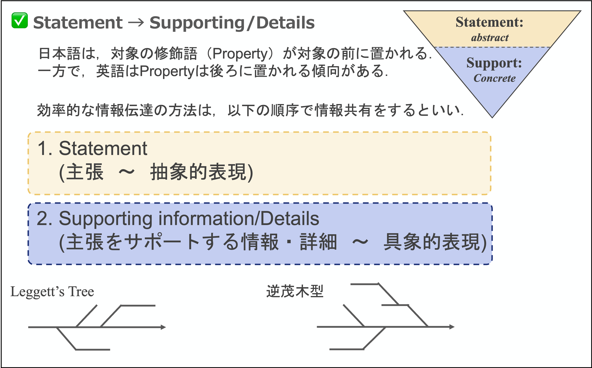

[🏠 Home](../../../README.md) › [🔬 研究ノウハウ](../README.md)

> 💡 **自分用ノート**

# 情報伝達・コミュニケーションの指針

効率的かつ説得力のある情報伝達を行うための，構造化のルールをまとめる．
3つのルールはそれぞれ「**順序**」「**裏付け**」「**出口**」に対応している．

| # | ルール | 答える問い |
|---|---|---|
| 1 | 抽象から具体へ | 何の話か？ |
| 2 | 視覚的エビデンス | 本当か？ |
| 3 | 空・雨・傘 | だから何をするのか？ |

---

## 1. 抽象から具体へ（Statement → Supporting Info）

「結論から話す」原則を意識する．

* **Statement（主張・結論）**
    * 最初に伝える．抽象度が高く，メッセージ性が強いもの．
    * 聞き手が「何の話か」を即座に理解できる枠組みを提供する．
* **Supporting Information / Details（根拠・詳細）**
    * 主張の後に記述する．Statement よりも抽象度が低く，具体的な事実やデータ．
    * 「なぜその結論になるのか？」という問いに答える形で構成する．

> 💬 この構造は論文の IMRaD とも対応している（[論文を書くときの注意点](./research_technique.md) を参照）．

## 2. 視覚的エビデンス（Graphical Image による証明）

言語的な主張（Statement）には，必ずそれを裏付ける視覚的根拠をセットにする．

* **役割**：Graphical Image（図表・グラフ・写真）は，Statement を証明するための客観的証拠である．
* **整合性**：「図で見れば一目で納得できる」状態を作る．
  **Statement と図のメッセージが 1 対 1 で対応している**ことが重要．

## 3. 意思決定を促す構成（空・雨・傘）

単なる事実の羅列（fact-only）を避け，情報の活用・アクションを意識した共有を行う．

| 段階 | 比喩 | 中身 |
|---|---|---|
| **状況** | 空が曇っている | 客観的事実（Fact） |
| **予想・解釈** | 雨が降りそうだ | 事実から導かれる予測・洞察（Insight / So What?） |
| **提案・行動** | 傘を持っていくべきだ | 予測に基づく具体的なアクション（Suggestion / Action） |

> **Note:**
> 情報を伝えるだけで終わると，相手に「So What?（だから何？）」と思われてしまう．
> 常に「この情報を使って今後どうするか」という **Suggest（提案）**までを含めること．

---

[⬅️ 研究ノウハウ](../README.md) ｜ [🏠 Home](../../../README.md)
