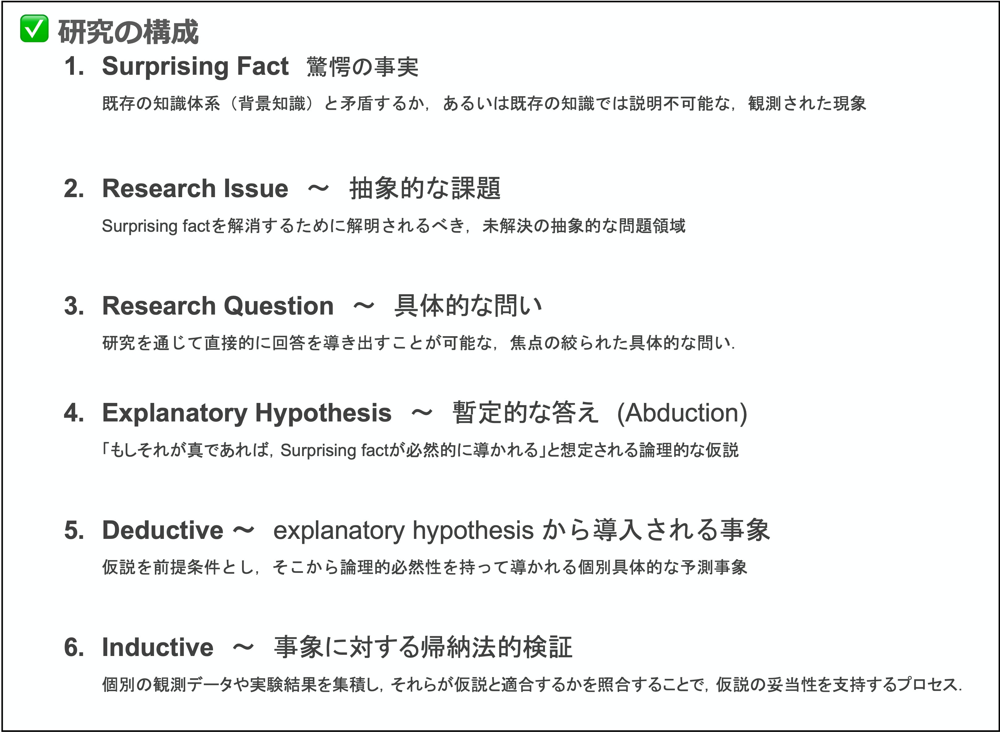

[🏠 Home](../../../README.md) › [🔬 研究ノウハウ](../README.md)

> 💡 **自分用ノート**

# 研究デザイン：パースのアブダクションに基づく探究プロセス

## 【指針】研究とは，既存体系の破綻を発見し，それを再構造化することである

この定義は，研究を**2つのフレーム**に分けている．

| フレーム | 内容 | 本稿での対応 |
|---|---|---|
| **① 発見** | 既存の知識体系における**異常・破綻**を見つけ出す | Surprising Fact の同定 → §2.1 |
| **② 再構造化** | その破綻が解消するよう，知識体系そのものを組み替える | Abduction・Deduction・Induction → §2，一般化 → §3 |

② は「穴を埋める」作業ではなく「組み替える」作業である．
破綻は個別の事実の欠落ではなく，**知識体系そのものの不整合**，つまり体系が現象の特定の性質を写し取る準同型性を失っていることを示すシグナルだからである．
破綻を当然のこととして飲み込める体系，すなわち新たな準同型性を担保する理論的枠組みを（もっともらしい仮説として）立て直すことが研究の実質である．
言い換えれば，研究とは**「驚き」を「当然」に変える**営みである．

本稿では，この手順を [C.S. Peirce](https://en.wikipedia.org/wiki/Charles_Sanders_Peirce) の
アブダクション（仮説的推論，abduction / retroduction）をもとに整理する．中心にあるのは次の推論のサイクルである．

$$
{\rm Surprising\ fact} \rightarrow {\rm Abduction} \rightarrow {\rm Deduction} \rightarrow {\rm Induction}
$$

---

## 1. 全体像：探究の四角形

研究の要素は，次のように一列に並べて説明されることが多い．



しかしこの6つは，(i) 抽象度が互いに異なり，(ii) パースの推論（Surprising Fact・Abduction・Deduction・Induction）と，
研究として成り立たせるための枠付け（Research Question・Research Issue）が混ざっている．
そこで本稿では，要素を次の**2つの軸**で並べ直す．

* **横の軸**：問い側（何が分からないか）と答え側（どう説明するか）
* **縦の軸**：具体（個別の事実・仮説）と抽象（広い範囲に通じる課題・メカニズム）

```
           QUESTION SIDE                          ANSWER SIDE

ABSTRACT   [A] Research Issue  <--- explains ---  [D] General mechanism
               ^                                      ^
               | generalize                           | generalize
               |                                      |
CONCRETE   Surprising Fact     <--- explains ---  [B] Explanatory hypothesis
           + Research Question                        |       ^
                                            deduction |       | induction
                                                      v       |
                                                  [C] Prediction & observation
```

**角**は研究の中身である．

| 位置 | 要素 | 内容 |
|---|---|---|
| 具体・問い側 | 驚愕の事実（Surprising Fact） | 既存理論の予測と食い違った，個別の観察．探究の出発点 |
| 〃 | Research Question | 驚愕の事実を，**この研究で答えを出す**問い（疑問文）にしたもの．[B] がその答えになる |
| 抽象・問い側 | [A] 研究課題（Research Issue） | 驚愕の事実を，その仲間全体に広げた未解決の課題（平叙文）．[D] がその答えになる |
| 具体・答え側 | [B] 説明仮説（Explanatory hypothesis） | 驚愕の事実を「当然」に変える仮説 |
| 〃 | [C] 予測と観測（Prediction & observation） | [B] から導いた予測と，それを確かめるデータ |
| 抽象・答え側 | [D] 一般的なメカニズム（General mechanism） | [B] を [A] の範囲全体へ広げたもの |

> 📎 [A]〜[D] は [研究申請書のテンプレート](./how_to_write_proposal.md) の記入順であり，四角形の位置の順ではない．
> 驚愕の事実と RQ はテンプレートの空欄にならないため，ラベルを付けていない．

**矢印**は推論や操作である．パースの3つの推論は下の段にある．

| 矢印 | 推論・操作 | 役割 |
|---|---|---|
| 下の横矢印 | **アブダクション** | 驚愕の事実を説明する [B] を見つける（§2.2） |
| [B] → [C] | **演繹** | [B] から予測を導く（§2.3） |
| [C] → [B] | **帰納** | 観測によって [B] を支持する（§2.4） |
| 縦の矢印 | **一般化** | 驚愕の事実を [A] へ，[B] を [D] へ広げる（§3） |

研究1本で実際に確かめられるのは**下の段だけ**であり，[A] のうち [B] で埋まるのはその一部にすぎない．
[D] は「[A] 全体にも同じ答えが通用する」という**提案**である．
研究目的とは，**この四角形が閉じる**こと，つまり下の段で確かめた答えを広げると上の段の課題にも答えられる，と主張するものである．

### 1.1 抽象と具体を行き来する操作

| 向き | 操作 | 例 | 確実さ |
|---|---|---|---|
| **具体へ降りる** | 当てはめる・範囲を狭める | 「すべての金属で成り立つ」→「この銅線で成り立つ」 | **確実**．広い範囲で正しいことは，その一部でも正しい |
| **抽象へ上る** | 広げる（一般化する） | 「この銅線で成り立つ」→「すべての金属で成り立つ」 | **飛躍を含む**．一部で正しくても，広げた先で正しいとは限らない |

研究のリスクも，結論が「現時点での最善の仮説」にとどまる理由も，**上る矢印の側**にある．
厳密な定義は [付録：論理学的視点](#付録論理学的視点) にまとめた．

---

## 2. 下の段：パースの推論サイクル

### 2.1 驚愕の事実（Surprising Fact）の同定

* 何が「驚き」なのかを言葉にし，既存のどの理論（background knowledge）と食い違っているのかをはっきりさせる．
* 単なる例外として片付けず，そこに「隠れた法則」がある可能性を考える．
* 驚きを **Research Question** の形にする．1つの驚きからは「なぜ起きるか」「どの条件で起きるか」など複数の問いが立ち，
  **どれを選ぶかで考えるべき仮説の範囲が決まる**ので，選んだ問いを明示する．

### 2.2 説明仮説の形成（Abduction）

パースの推論形式は以下のとおり．

> 1. 驚愕の事実 $C$ が観察される．
> 2. もし仮説 $H$ が真であれば，$C$ は当然の事柄（matter of course）となるだろう．
> 3. よって，$H$ が真であると疑うべき理由がある．

仮説 $H$ は当てずっぽうではなく，**導入すると不可解だった現象が筋の通った当たり前の現象に変わる**ような，
飛躍を伴う洞察（insight）でなければならない．パースは良い仮説の条件として次の4つを挙げている．

| 条件 | 内容 |
|---|---|
| **Plausibility（もっともらしさ）** | 直感的に妥当であること |
| **Verifiability（検証可能性）** | 正しいか間違っているかを確かめられること |
| **Simplicity（単純性）** | 説明が簡潔であること |
| **Economy（経済性）** | 追いかけるコストが見合っていること |

### 2.3 演繹的予測（Deduction）

「もし $H$ が正しいなら，条件 $X$ のもとで結果 $Y$ が得られるはずだ」という，実験や観察で確かめられる予測を導く．
仮説を特定の条件に当てはめる降りる操作なので，予測は確実に導ける．

### 2.4 経験的検証（Induction）

予測を，実験・フィールド調査・インタビュー・データ分析など最も適した手法で確かめる．

| 結果 | 次の行動 |
|---|---|
| 予測が**支持された** | 仮説 $H$ の確からしさ（plausibility）が高まる |
| 予測が**支持されなかった** | 仮説を修正するか，これを新たな驚愕の事実として **§2.1 へ戻す** |

限られたデータから仮説全体を支持するのは上る操作なので，支持されても「証明」されたわけではない．

> 📎 **関連する考え方**
> * **D. Solow の Forward-Backward Method**：驚愕の事実の同定は backward method の起点にあたる．
>   ただし forward process は assumption から出発し，backward process で得た主張の証明を目指すので，パースの演繹とは出発点と到着点が異なる．
>   また backward process の**抽象質問**は十分条件を明確にするための抽象化であり，問題の方向性を決める RQ とは役割が違う．
> * **G. Pólya の Heuristic Reasoning**（*How to Solve It*）：アブダクションに近い．
>   アブダクションは科学的発見のプロセスを一般化した概念なので，その具体例が各分野にあるのは自然である．

---

## 3. 縦の矢印：研究として意味のある大きさに広げる

下の段だけでは「1つの珍しい現象を1つの仮説で説明した」で終わってしまう．
研究として意味を持たせるには，問い側と答え側をそれぞれ一段抽象に上げる．

### 3.1 驚愕の事実 → 研究課題（Research Issue）

その驚きが**どんな現象の仲間の一例なのか**を考え，「その仲間全体で既存理論がうまくいっていない」という形にまとめる．
これによって，解明することの理論的・実用的な意義と，既存研究の中での位置づけ（リサーチ・ギャップ）が示せる．
この広げ方も上る操作なので，「仲間全体でうまくいっていない」こと自体を先行研究などで裏付けておく．

> 📎 パースの推論だけを見るなら，研究課題は驚愕の事実にまとめてもよい．
> それでも分けるのは，[A] が [D] と対になる位置にあり，[A] を省くと [D] が何に答えているのかが言えなくなるためである．

### 3.2 説明仮説 → 一般的なメカニズム

確かめた仮説 [B] の広げ方には2通りある．[D] を書くときは，どちらの意味で広げたのかを意識すると主張がぶれにくい．

| 広げ方 | 内容 | 主張の形 |
|---|---|---|
| **対象の範囲を広げる** | 同じ仮説が，より多くの対象で成り立つとする | 「同じしくみが，もっと広く効いている」 |
| **仮説の中身を抽象化する** | 仮説に含まれる具体的な値や条件を外し，より一般的なしくみとして言い直す | 「もっと根本的なしくみがあり，[B] はその一例である」 |

最初の [B] は [A] の範囲を全部説明できなくてよい．
驚愕の事実を説明できる狭い範囲でまず確かめ，そこから広げればよい（**仮説の経済性**）．

---

## 【まとめ】

**四角形を1回閉じることが1回の再構造化**であり，知識体系はこれを繰り返して更新されていく．
得られる理論は絶対不変の真理ではなく，人間の知識の可謬性（fallibilism）を前提とした「現時点での最善の仮説」である．
これを研究目的の文章に落とし込む方法は [研究申請書の書き方](./how_to_write_proposal.md) にまとめた．

---

## 付録：論理学的視点

本文の「抽象と具体の往復」を一階述語論理の言葉で書き直し，
本文の構造（四角形と，上る/降りる操作の非対称）の根拠を示す．

### A.1 記法

| 記号 | 意味 |
|---|---|
| $T$ | 背景理論（既存の知識体系） |
| $a$ | 驚愕の事実が観察された個体（対象・事例） |
| $C(x)$ | 観察された性質．驚愕の事実は $C(a)$ |
| $K$ | $a$ を含む現象のクラス（$a \in K$） |
| $D_B$ | 説明仮説が主張される対象領域 |
| $H(x)$ | 説明仮説の述語 |
| $H^{*}(x;\theta)$ | パラメータ $\theta$ を持つ，より抽象的な述語．$H(x) \equiv H^{*}(x;\theta_0)$ |

### A.2 2つの層と4つの操作

「抽象 ↔ 具体」の移動は，**概念の層**と**命題の層**で別の操作として現れる．

| 層 | 降りる操作（具体化） | 上る操作（抽象化） |
|---|---|---|
| **概念**（内包・外延） | **個別化**：クラス $K$ からその元 $a$ を取り出す（$a \in K$） | **外延化**：個体 $a$ から，それを含むクラス $K$ へ移る |
| **命題**（量化と領域） | ① **代入**（全称例化）：$\forall x \in D.\,H(x) \vdash H(a)$　$(a \in D)$ | ③ **領域の拡張**：$\forall x \in D'.\,H(x)$ から $\forall x \in D.\,H(x)$ へ $(D' \subsetneq D)$ |
| | ② **領域の制限**：$\forall x \in D.\,H(x) \vdash \forall x \in D'.\,H(x)$　$(D' \subseteq D)$ | ④ **述語の抽象化**：$H(x) \equiv H^{*}(x;\theta_0)$ の固定値 $\theta_0$ を，対象ごとに定まる $\theta(x)$ に置き換える |

概念の層では，**元であること**（membership，$a \in K$）と**部分クラスであること**（subsumption，$K' \subseteq K$）を区別する．
個別化・外延化は前者，領域の制限・拡張は後者に対応する．

### A.3 非対称性：真理保存と拡張的推論

* **降りる操作（①②）は真理を保存する**．前提が真なら結論も必ず真であり，演繹的に妥当である．
* **上る操作（外延化，③④）は真理を保存しない**．$H(a)$ や $\forall x \in D'.\,H(x)$ が真でも，
  $\forall x \in D.\,H(x)$ が真である保証はない．これらは内容を増やす推論（ampliative inference）である．

パースの3つの推論はこの区別に対応する．

| 推論 | 方向 | 妥当性 |
|---|---|---|
| 演繹 | 降りる（①②） | 真理保存的 |
| 帰納 | 標本 $S \subseteq D_B$ から $D_B$ へ上る（③の一種） | 拡張的 |
| アブダクション | 観察 $C(a)$ から，それを含意する仮説 $H$ へ遡る | 拡張的 |

四角形の縦の矢印も拡張的である．[A] は外延化（$a \to K$）によって $T \nvdash C(a)$ を $K$ 全体へ広げた主張であり，
[D] は③④によって [B] を広げた主張である．どちらも真であることは保証されず，裏付けを要する．

本文の可謬性は，探究が拡張的推論を含む限り避けられないという事実の言い換えである．

### A.4 各要素の論理形式

| 要素 | 論理形式 | 備考 |
|---|---|---|
| **驚愕の事実** | $C(a)$ が観察され，かつ $T \vdash \neg C(a)$（矛盾型）または $T \nvdash C(a)$（説明不能型） | 驚きは $T$ に相対的 |
| **Research Question** | $?H.\ \ T \wedge H \vdash C(a)$ | 答えの候補を仮説 $H$ の集合として定める疑問．許す $H$ の型（どんなメカニズムを考えるか）を制限する |
| **[A] 研究課題** | $a \in K$ かつ $\forall x \in K.\ T \nvdash C(x)$ | 驚愕の事実の**外延化**．課題の意義は $K$ の広さに対応する |
| **[B] 説明仮説** | $T \wedge \forall x \in D_B.\,H(x) \vdash C(a)$，ただし $a \in D_B \subsetneq K$ | $D_B \subsetneq K$ が**仮説の経済性** |
| **[C] 予測と観測** | 演繹：$T \wedge \forall x \in D_B.\,H(x) \vdash Y(x_0)$（$x_0 \in D_B$，条件 $X$ のもと）<br>帰納：標本 $S \subseteq D_B$ で $Y$ を観測し，$\forall x \in D_B.\,H(x)$ の支持を得る | 演繹は①，帰納は③ |
| **[D] 一般的メカニズム** | $\forall x \in K.\,H^{*}(x;\theta(x))$，ただし $x \in D_B$ では $\theta(x) = \theta_0$ | [B] から③（$D_B \to K$）と④（$\theta_0 \to \theta(x)$）で得る |

アブダクションの推論形式は，この記法で次のように書ける．

$$
\frac{C(a) \qquad T \wedge H \vdash C(a)}{\therefore\ H \text{ を疑うべき理由がある}}
$$

形式だけ見れば後件肯定であり，演繹的には妥当でない．
ただしパースの結論は「$H$ は真である」ではなく「$H$ を**検討する価値がある**」という様相的な主張であり，
アブダクションは真理の推論ではなく**探究の対象を選ぶ推論**として位置づけられる．

### A.5 四角形が閉じる条件

本文の四角形は，次の2条件が成り立つとき「閉じる」．

1. **[D] が [A] に答える**：$\forall x \in K.\ \ T \wedge \forall y \in K.\,H^{*}(y;\theta(y)) \vdash C(x)$
2. **[D] が [B] を特殊ケースとして含む**：[D] に②（$K \to D_B$）を施すと，$\theta(x) = \theta_0$ により [B] に戻る

条件2は [D] の作り方（$D_B$ 上で $\theta(x) = \theta_0$ とすること）で保証される．
問題は条件1，すなわち [B] から [D] へ上る段階であり，研究の新規性も危うさもここに集中する．
1本の研究が [C] で検証するのは $D_B$ 上の [B] だけなので，条件1は $K \setminus D_B$ の部分については提案にとどまる．

### A.6 このモデルの限界

* **説明の形式**：「$T \wedge H \vdash C$」は Hempel の演繹的・法則的説明（DN モデル）に相当する．
  統計的な説明や因果メカニズムによる説明は，この形式では十分に表せない．
* **内包と外延の反比例**：内包を増やすと外延が狭まる，という古典的な法則は厳密には成り立たない
  （すでに含意される性質を内包に加えても，外延は変わらない）．
* **形式化の位置づけ**：ここでの記述は構造を見通すためのモデルであり，
  実際の研究の推論を完全に形式化したものではない．

---

[⬅️ 研究ノウハウ](../README.md) ｜ [🏠 Home](../../../README.md)
