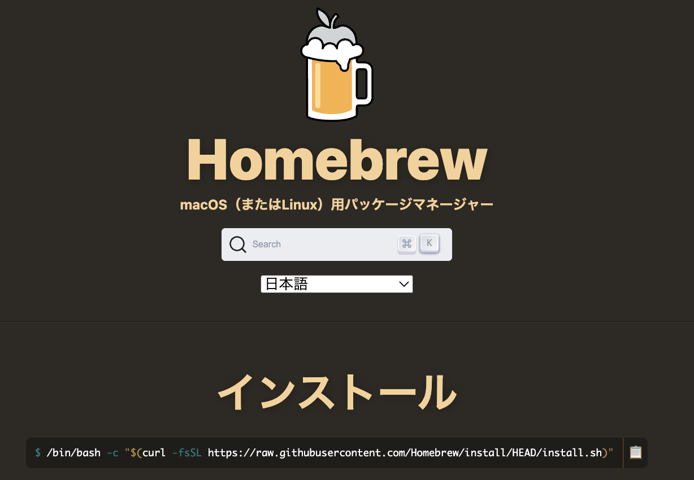

[🏠 Home](../../../../README.md) › [🛠️ IT・開発環境](../../README.md) › [Python 環境構築](../environment.md)

# 🍺 Homebrew のインストール

## 1. Homebrew とは？

**Homebrew** は，macOS や Linux 向けの**パッケージマネージャ（パッケージ管理ソフト）**である．
ターミナル上でソフトウェアのインストール・アップデート・アンインストールを行うことができ，
開発環境の構築やツールの管理を効率化できる．

<figure style="text-align:center;">
  
  <figcaption style="font-size:20px; margin-top:5px;">Fig: Homebrew</figcaption>
</figure>

### ✅ 特徴

* **簡単なコマンド**でソフトウェアをインストールできる（例：`brew install python`）
* macOS 標準の環境に影響を与えにくい
* オープンソースで活発にメンテナンスされている
* `brew install`, `brew update`, `brew uninstall` など直感的なコマンド体系
* CUI ツールだけでなく GUI アプリ（例：Google Chrome）も `brew install --cask` で管理できる

---

## 2. インストール方法

[Homebrew](https://brew.sh/ja/) は以下のコマンド1行でインストールできる．

```bash
/bin/bash -c "$(curl -fsSL https://raw.githubusercontent.com/Homebrew/install/HEAD/install.sh)"
```

実行すると，途中でいくつか質問が表示されるが，基本的にはデフォルトの設定で進めて問題ない．

* **最初にパスワードの入力を求められる．** これは Homebrew が必要なディレクトリにアクセスする
  権限を取得するためで，ご自身の Mac のログインパスワードを入力する．
* その後，必要な依存関係やツールが自動的にインストールされる．
  **数十分かかることもある**ので，しばらく待つこと．

> ⚠️ インストールに失敗する場合，多くは **Xcode（Command Line Tools）のバージョンが古い**ことが原因である．
> Xcode をアップデートしてから再試行すること．

## 3. インストールの確認

```bash
brew doctor

# 正しくインストールされていれば，以下のように表示される
# Your system is ready to brew.
```

確認が済んだら，よく使うパッケージを入れてみる．

```bash
brew install wget      # URL からファイルをダウンロードする
brew install gnuplot   # グラフ描画
brew install git       # バージョン管理（後述）
brew install git-open  # ターミナルから GitHub のページを開く
brew install pyenv     # Python のバージョン管理

brew list              # インストール済みパッケージの確認
```

## 4. 🔧 よく使うコマンド

| 操作 | コマンド例 |
|---|---|
| パッケージのインストール | `brew install git` |
| GUI アプリのインストール | `brew install --cask google-chrome` |
| インストール済み一覧の表示 | `brew list` |
| 古いパッケージがないか確認 | `brew outdated` |
| Homebrew 自体の更新 | `brew update` |
| パッケージの更新 | `brew upgrade` |
| パッケージのアンインストール | `brew uninstall git` |
| 古いバージョンの削除 | `brew cleanup` |
| キャッシュの削除 | `brew cleanup -s` |
| 不要パッケージの削除 | `brew autoremove` |

> 💡 Homebrew のパッケージは macOS のアップデートに伴って更新されることが多い．
> 定期的に `brew update && brew upgrade` を実行して最新の状態に保つことを勧める．

## 5. 💡 補足

* Homebrew のインストール先は **`/opt/homebrew`（Apple Silicon）**または **`/usr/local`（Intel Mac）**．
  計算コードのビルド時に `makefile` へ書くパスが変わるので，自分がどちらかは把握しておくこと．
* Homebrew でインストールしたツールは，システムの Python や Git などと**競合せずに並行して使用できる**．
* 開発環境をコードベースで再現したい場合は `brew bundle` が便利．

## 6. Git のインストール

Git はバージョン管理システムで，ソースコードの管理に使用する（[GitHub とは？](../../github/github.md) を参照）．

macOS にはデフォルトで Git が入っているが，**最新バージョンを使うために Homebrew 経由での
インストールを勧める**．

```bash
brew install git
```

---

次は [🐍 pyenv のインストール](./pyenv.md) へ進む．

[⬅️ Python 環境構築](../environment.md) ｜ [🏠 Home](../../../../README.md)
